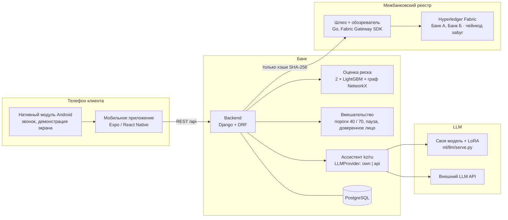

# Sabyr

**Sabyr** («сабыр» — терпение, спокойствие) — модуль мобильного банка, который срабатывает перед переводом денег
и защищает клиента от социальной инженерии: звонков «службы безопасности», фейковых магазинов, дропперов.

Мошенник убеждает клиента перевести деньги самому, поэтому обычный транзакционный антифрод такие операции
пропускает. Sabyr оценивает **обе стороны перевода** — поведение отправителя и «паспорт» получателя — и
вмешивается **диалогом, а не блокировкой**: объясняет, что его насторожило, задаёт вопрос, даёт паузу и
подключает близкого человека. Сведения о счетах-дропах банки передают друг другу через общий реестр на
Hyperledger Fabric — без персональных данных, только хэши.

Кейс Банка ЦентрКредит «Инновации в банкинге и кибербезопасность». Все данные в репозитории синтетические.

| | |
|---|---|
|  |  |
| Экран Sabyr: риск, пауза, причины | Запрос у доверенного лица |


## Запуск одной командой

Нужны Docker (compose v2), git, curl, jq и Go ≥ 1.23 (Go нужен скрипту Fabric для сборки чейнкода).

```bash
cp .env.example .env        # поменяйте пароли; для ассистента добавьте ANTHROPIC_API_KEY
make demo
```

`make demo` поднимает сеть Fabric (2 организации, канал и чейнкод `sabyr`), PostgreSQL, backend, шлюз реестра
и готовит данные сценария (`seed_demo`). После этого:

| Что | Где |
|---|---|
| API и Swagger | http://localhost:8000/api/docs |
| Обозреватель реестра | http://localhost:8090 |
| Мобильное приложение | `cd mobile && npm install && npx expo start` (web или Android dev build, см. [mobile/README.md](mobile/README.md)) |
| Проверка сценария по HTTP | `python scripts/demo_check.py` |

Только backend и БД, без блокчейна: `docker compose up -d --build && make seed` (в ответах API будет
`ledger.status = "unavailable"`, остальное работает).

## Сценарий демо

1. **Гульнара Сейткали** (62 года, Банк А) получает звонок, во время разговора открывает приложение и переводит
   1 500 000 ₸ на новый счёт `KZ11SBA0000000007777`.
2. Sabyr показывает риск больше 70 и три причины на казахском; ассистент спрашивает про «безопасный счёт».
3. Включается пауза 15 минут, запрос уходит её сыну **Данияру Сейткали** — он отклоняет перевод.
4. В обозревателе реестра появляются запись о предупреждении и отметка: счёт получателя — дроп.
5. **Айдос Нурланов** из Банка Б переводит на тот же счёт и сразу видит отметку из реестра.

Пошаговая инструкция для показа — [docs/demo.md](docs/demo.md). Весь сценарий автоматически проверяет
`scripts/demo_check.py` (против живого стенда с Fabric) и тест `backend/tests/test_demo_scenario.py`.

## Архитектура



Подробнее — [docs/architecture.md](docs/architecture.md).

| Каталог | Содержимое |
|---|---|
| `backend/` | Django 5 + DRF + PostgreSQL: API, пороги вмешательства, доверенное лицо, ассистент, клиент реестра |
| `ml/` | Генератор синтетики, признаки, граф, обучение LightGBM, причины на kz/ru; `ml/llm` — датасет и LoRA |
| `ledger/` | Чейнкод (Go), скрипты сети на базе test-network, шлюз и «Обозреватель реестра» |
| `mobile/` | Приложение на Expo (kz/ru), нативный модуль сигналов для Android, демо-меню |
| `docs/` | Архитектура, сценарий демо, OpenAPI, метрики модели, скриншоты |

## Как считается риск

Риск 0–100 складывается из двух частей (`risk = 1 − (1 − p_отправителя)·(1 − p_получателя)`):

- **контекст отправителя** — идёт звонок, включена демонстрация экрана, получатель новый, сумма нетипична,
  недавно взят кредит на близкую сумму, ночь, спешка в сессии;
- **паспорт получателя** — возраст счёта, число уникальных отправителей, доля входящих от незнакомых, скорость
  вывода, графовые признаки (степень, PageRank, близость к помеченным дропам) и отметка в межбанковском реестре.

| Риск | Действие |
|---|---|
| < 40 | перевод проходит |
| 40–70 | предупреждение и вопросы ассистента |
| > 70 | пауза охлаждения 15 минут и запрос подтверждения у доверенного лица |

Вместе с числом модель возвращает три главные причины человеческим языком на казахском и русском и вероятную
схему (безопасный счёт, фейковый магазин, инвестиции, родственник в беде, курьер). Метрики на синтетике —
[docs/model_metrics.md](docs/model_metrics.md).

## API

`POST /api/transfers/check`, `POST /api/transfers/confirm`, `POST /api/assistant/message`,
`POST /api/trusted/request`, `POST /api/trusted/respond`, `GET /api/recipients/{id}/passport`,
`GET /api/ledger/warnings/{transferHash}` и служебные методы. Спецификация: [docs/openapi.yaml](docs/openapi.yaml),
Swagger на работающем стенде — `/api/docs`.

## Тесты

```bash
python -m venv .venv && .venv/bin/pip install -r backend/requirements-dev.txt && .venv/bin/pip install -e ml
make test-ml          # генератор данных, логика риска, датасет диалогов
docker compose up -d db
DATABASE_URL=postgres://sabyr:<пароль из .env>@localhost:5432/sabyr make test-backend   # пороги, сценарий демо, ассистент, OpenAPI
make test-chaincode   # чейнкод
cd mobile && npm install && npx tsc --noEmit && npx jest
```

## Настройки

Секреты — только через `.env` (пример в [.env.example](.env.example)).

| Переменная | Назначение |
|---|---|
| `LLM_PROVIDER` | `api` — внешний LLM API, `own` — своя дообученная модель ([ml/llm/README.md](ml/llm/README.md)) |
| `ANTHROPIC_API_KEY` | ключ внешнего API; без него ассистент отвечает заранее согласованными текстами (`provider=static`) |
| `LEDGER_SALT` | общая для банков соль хэшей реестра |
| `LEDGER_GATEWAY_URL` | адрес шлюза реестра |
| `SABYR_COOLDOWN_MINUTES` | длительность паузы (для показа можно уменьшить) |

## Ограничения MVP

- Модель риска обучена на синтетике; цифры из отчёта нельзя переносить на реальные данные.
- Вход в приложение — выбор демо-пользователя; настоящая аутентификация остаётся за мобильным банком.
- Счёт помечается дропом автоматически после отказа доверенного лица; в бою перед этим нужна проверка аналитиком.
- Своя LLM: датасет и скрипты готовы, веса не обучались (нужен GPU) — см. [ml/llm/README.md](ml/llm/README.md).
- Android-сборка приложения и нативный модуль не проверялись на устройстве — см. [mobile/README.md](mobile/README.md).
