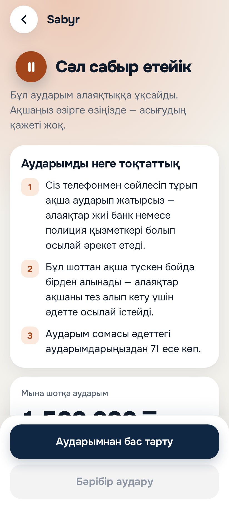
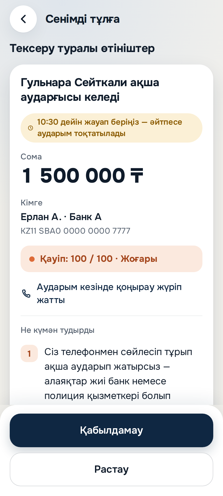
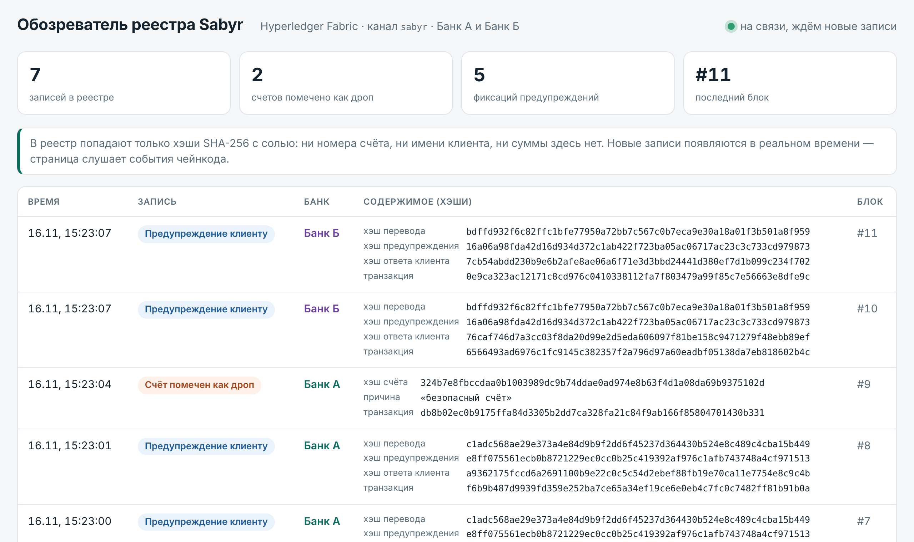
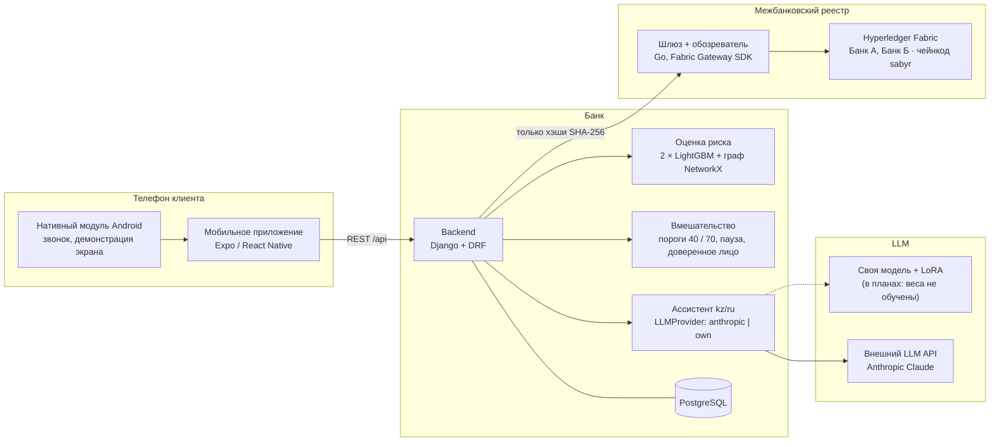

# Sabyr

**Sabyr** («сабыр» — терпение, спокойствие) — модуль мобильного банка, который срабатывает перед переводом денег
и защищает клиента от социальной инженерии: звонков «службы безопасности», фейковых магазинов, дропперов.

Мошенник убеждает клиента перевести деньги самому, поэтому обычный транзакционный антифрод такие операции
пропускает. Sabyr оценивает **обе стороны перевода** — поведение отправителя и «паспорт» получателя — и
вмешивается **диалогом, а не блокировкой**: объясняет, что его насторожило, задаёт вопрос, даёт паузу и
подключает близкого человека. Сведения о счетах-дропах банки передают друг другу через общий реестр на
Hyperledger Fabric — без персональных данных, только хэши.

Кейс Банка ЦентрКредит «Инновации в банкинге и кибербезопасность». Все данные в репозитории синтетические.

| | |
|---|---|
|  |  |
| Экран Sabyr: риск, пауза, причины | Запрос у доверенного лица |



## Запуск одной командой

Нужны Docker (compose v2), git, curl, jq и Go ≥ 1.23 (Go нужен скрипту Fabric для сборки чейнкода).

```bash
cp .env.example .env        # поменяйте пароли и LEDGER_GATEWAY_TOKEN, вставьте LLM_API_KEY
make demo
```

`make demo` поднимает сеть Fabric (2 организации, канал и чейнкод `sabyr`), PostgreSQL, backend, шлюз реестра
и готовит данные сценария (`seed_demo`). Первый запуск — около 10 минут (скачиваются образы Fabric), потом — 1–2 минуты.

| Что | Где |
|---|---|
| API и Swagger | http://localhost:8000/api/docs |
| Обозреватель реестра | http://localhost:8090 |
| Мобильное приложение | `cd mobile && npm install && npx expo start` (web или Android dev build, см. [mobile/README.md](mobile/README.md)) |
| Страница проекта и презентация | https://sabyr-three.vercel.app/pitch/ — лендинг и анимированная презентация в браузере (→ листать, F — полный экран, T — текст, P — окно ведущего) |
| Веб-версия приложения | https://sabyr-three.vercel.app — ходит в API, указанный в «Демо-меню» (по умолчанию `http://localhost:8000`, то есть в стенд на вашей машине) |
| Проверка сценария по HTTP | `python scripts/demo_check.py` |
| Чистый лист перед повторным показом | `make demo-reset` (новый реестр + свежие данные) |

Порты заняты другими проектами — поменяйте `API_PORT`, `DB_PORT`, `LEDGER_PORT` в `.env`.

Только backend и БД, без блокчейна: `docker compose up -d --build && make seed` (в ответах API будет
`ledger.status = "unavailable"`, остальное работает).

## Что реально работает, а что в планах

Проверено прогоном на живом стенде (Fabric + backend + настоящая LLM), а не только тестами.
Подробный разбор — [docs/AUDIT.md](docs/AUDIT.md).

| Часть | Статус |
|---|---|
| Оценка риска: 2 × LightGBM (отправитель, получатель) + классификатор схемы | ✅ модели обучены и вызываются; причины выбираются по SHAP-вкладам |
| Паспорт получателя и графовые признаки (NetworkX) | ✅ из истории переводов; отметка дропа сразу обновляет его соседей в графе, полный пересчёт — `make refresh-graph` |
| Причины риска человеческим языком | ✅ LLM переписывает шаблонные причины; каждая принимается, только если совпали код и все числа и язык верный, иначе шаблон (поле `source` в ответе API) |
| ИИ-ассистент kz/ru (2–4 реплики, вопрос под схему) | ✅ настоящая LLM через слой `LLMProvider` (`LLM_API_KEY`, `LLM_MODEL`); при недоступности — заготовленные тексты, `provider=static`; защита от prompt injection на входе и выходе (`backend/assistant/guard.py`) |
| Пауза 15 минут, пороги 40 / 70, доверенное лицо | ✅ блокировки проверяются на сервере; запрос доверенному лицу — через backend, опрос раз в 3 с |
| Межбанковский реестр на Hyperledger Fabric | ✅ запись и чтение через шлюз на Go; в реестре только ключевые хэши HMAC-SHA256; шлюз принимает запросы только с `LEDGER_GATEWAY_TOKEN` |
| Срок ответа доверенного лица, звонок одной кнопкой | ✅ без ответа за 30 минут перевод отменяется, деньги остаются у клиента; кнопки «Позвонить» доверенному лицу и банку; привязка доверенного лица в приложении |
| Перевод по номеру телефона | ✅ получатель — телефон или номер счёта |
| «Сообщить о мошенничестве» после отмены перевода | ✅ `POST /api/transfers/report`: счёт получателя помечается в реестре, ответ клиента фиксируется |
| Мобильное приложение (Expo, kz/ru) | ✅ в web все экраны ходят в настоящий API; e2e-прогон 36/36 |
| Нативные сигналы Android (звонок, демонстрация экрана) | ⚠️ модуль написан, на устройстве **не проверялся**; в демо сигнал звонка включается в демо-меню |
| Своя дообученная LLM (`LLM_PROVIDER=own`) | 🕓 в планах: датасет 1600 диалогов и скрипты LoRA готовы, веса не обучены (нужен GPU) — [ml/llm/README.md](ml/llm/README.md) |
| Push-уведомление доверенному лицу | 🕓 в планах (сейчас — опрос, приложение должно быть открыто) |

Скорость на стенде (Claude Opus 5.5, effort low): реплика ассистента ~3,5 с, проверка перевода с причинами от LLM ~6–7 с.
Если LLM не ответила за отведённое время, остаются шаблонные причины и заготовленный текст — приложение не зависает.

## Сценарий демо

Перед показом: `make demo-reset`. Три окна: приложение (Гульнара), второе окно или телефон (Данияр),
обозреватель реестра http://localhost:8090.

1. **Гульнара Сейткали** (62 года, Банк А) входит в приложение; в демо-меню (пять нажатий на логотип) включает
   «идёт звонок» и подставляет счёт `KZ11SBA0000000007777`. Перевод 1 500 000 ₸.
2. Sabyr показывает риск больше 70 и три причины на казахском, сформулированные LLM; схема — «Қауіпсіз шот».
3. Ассистент сам начинает разговор на казахском: спрашивает, не звонят ли ей из «банка» или «полиции»,
   и объясняет схему простыми словами. Кнопка «Бәрібір аудару» неактивна — идёт пауза 15 минут.
4. Запрос уходит её сыну **Данияру Сейткали**: у него на главной значок «1», в запросе видны сумма и причины.
   Данияр нажимает «Отклонить» — экран Гульнары сам переключается на «перевод отклонён, деньги на счёте».
5. В обозревателе появляются записи: два «Предупреждение клиенту» и «Счёт помечен как дроп» — только хэши.
6. **Айдос Нурланов** из Банка Б переводит 60 000 ₸ на тот же счёт без звонка и сразу видит риск 85 и
   причину «счёт отмечен в межбанковском реестре», хотя его банк этот счёт раньше не видел.

Подробная инструкция для показа — [docs/demo.md](docs/demo.md). Весь сценарий автоматически проверяет
`scripts/demo_check.py` (против живого стенда с Fabric) и тест `backend/tests/test_demo_scenario.py`.

## Архитектура



Подробнее — [docs/architecture.md](docs/architecture.md).

| Каталог | Содержимое |
|---|---|
| `backend/` | Django 5 + DRF + PostgreSQL: API, пороги вмешательства, доверенное лицо, ассистент, клиент реестра |
| `ml/` | Генератор синтетики, признаки, граф, обучение LightGBM, причины на kz/ru; `ml/llm` — датасет и LoRA |
| `ledger/` | Чейнкод (Go), скрипты сети на базе test-network, шлюз и «Обозреватель реестра» |
| `mobile/` | Приложение на Expo (kz/ru), нативный модуль сигналов для Android, демо-меню |
| `docs/` | Архитектура, сценарий демо, OpenAPI, метрики модели, скриншоты |

## Как считается риск

Риск 0–100 складывается из двух частей (`risk = 1 − (1 − p_отправителя)·(1 − p_получателя)`):

- **контекст отправителя** — идёт звонок, включена демонстрация экрана, получатель новый, сумма нетипична,
  недавно взят кредит на близкую сумму, ночь, спешка в сессии;
- **паспорт получателя** — возраст счёта, число уникальных отправителей, доля входящих от незнакомых, скорость
  вывода, графовые признаки (степень, PageRank, близость к помеченным дропам) и отметка в межбанковском реестре.

| Риск | Действие |
|---|---|
| < 40 | перевод проходит |
| 40–70 | предупреждение и вопросы ассистента |
| > 70 | пауза охлаждения 15 минут и запрос подтверждения у доверенного лица |

Вместе с числом модель возвращает три главные причины человеческим языком на казахском и русском и вероятную
схему (безопасный счёт, фейковый магазин, инвестиции, родственник в беде, курьер). Метрики на синтетике —
[docs/model_metrics.md](docs/model_metrics.md).

## API

`POST /api/transfers/check`, `POST /api/transfers/confirm`, `POST /api/transfers/report`, `POST /api/assistant/message`,
`POST /api/trusted/request`, `POST /api/trusted/respond`, `GET /api/recipients/{id}/passport`,
`GET /api/ledger/warnings/{transferHash}` и служебные методы. Спецификация: [docs/openapi.yaml](docs/openapi.yaml),
Swagger на работающем стенде — `/api/docs`.

## Тесты

```bash
python -m venv .venv && .venv/bin/pip install -r backend/requirements-dev.txt && .venv/bin/pip install -e ml
make test-ml          # генератор данных, логика риска, датасет диалогов
docker compose up -d db
DATABASE_URL=postgres://sabyr:<пароль из .env>@localhost:5432/sabyr make test-backend   # пороги, сценарий демо, ассистент, OpenAPI
make test-chaincode   # чейнкод
cd mobile && npm install && npx tsc --noEmit && npx jest
```

Тесты backend никогда не ходят в настоящий LLM API: провайдер подменяется, ключ в тестах обнуляется.
Если `python -m venv` недоступен (нет пакета `python3-venv`), тесты можно гонять в образе backend:
`docker run --rm --network sabyr_default -v "$PWD":/src -w /src/backend -e DATABASE_URL=postgres://sabyr:<пароль>@db:5432/sabyr sabyr-backend sh -c "pip install -q pytest pytest-django scikit-learn pyarrow && pytest -q"`.

## Настройки

Секреты — только через `.env` (пример в [.env.example](.env.example)).

| Переменная | Назначение |
|---|---|
| `LLM_PROVIDER` | `anthropic` — внешний LLM API, `own` — своя дообученная модель ([ml/llm/README.md](ml/llm/README.md)) |
| `LLM_API_KEY` | ключ LLM API; без него ассистент отвечает заранее согласованными текстами (`provider=static`), причины — шаблоны |
| `LLM_MODEL` | модель; пусто — `claude-opus-5-5` |
| `LLM_TIMEOUT_SECONDS`, `LLM_MAX_RETRIES` | бюджет времени на ответ (по умолчанию 6 с × 2 попытки — меньше таймаута приложения 20 с) |
| `LLM_REASONS` | `1` — LLM переписывает причины риска (с проверкой фактов), `0` — только шаблоны |
| `LEDGER_SALT` | общая для банков соль хэшей реестра |
| `LEDGER_GATEWAY_URL`, `LEDGER_GATEWAY_TOKEN` | адрес шлюза реестра и общий секрет backend ↔ шлюз |
| `API_PORT`, `DB_PORT`, `LEDGER_PORT` | порты стенда на хосте |
| `SABYR_COOLDOWN_MINUTES` | длительность паузы (для показа можно уменьшить) |

## Место на рынке

Что уже есть у банков и регулятора (доверенный контакт Kaspi, Антифрод-центр НБ РК, блокировка операций при звонке),
чем Sabyr от этого отличается и чего утверждать нельзя — в [docs/competitors.md](docs/competitors.md). Коротко: Sabyr
не заменяет эти меры, а добавляет то, чего в них нет, — объяснение и диалог на языке клиента под конкретную схему,
оценку получателя для схем без звонка и неизменяемое доказательство показанного предупреждения.

## Ограничения MVP

- Модель риска обучена на синтетике; цифры из отчёта нельзя переносить на реальные данные.
- Вход в приложение — выбор демо-пользователя; настоящая аутентификация остаётся за мобильным банком.
- Сверки с базой Антифрод-центра НБ РК нет (доступ к ней есть только у банков); её место в схеме — рядом с отметкой реестра.
- Счёт помечается дропом автоматически после отказа доверенного лица; в бою перед этим нужна проверка аналитиком.
- Своя LLM: датасет и скрипты готовы, веса не обучались (нужен GPU) — см. [ml/llm/README.md](ml/llm/README.md).
- Шлюз реестра в демо держит удостоверения обоих банков; в бою у каждого банка свой шлюз и свои ключи.
- Метрики модели (ROC-AUC 0.999) получены на синтетике, где схемы заметно отделимы; на реальных данных будут ниже.
- Android-сборка приложения и нативный модуль не проверялись на устройстве — см. [mobile/README.md](mobile/README.md).
