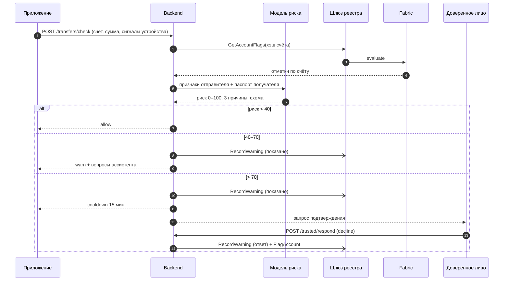

# Архитектура Sabyr

## Поток проверки перевода

## Компоненты

### Оценка риска (`ml/sabyr_ml`, `backend/risk`)

- `datagen.py` — синтетика: ~5 000 клиентов, ~200 000 переводов за 90 дней, пять схем, метки fraud/legit.
- `features.py` — признаки. Состояние «паспорта» счёта (счётчики входящих, незнакомые отправители, интервалы
  «пришло → ушло») хранится как JSON и обновляется одним и тем же кодом при обучении и в бою.
- `graph.py` — граф переводов на NetworkX: входящая степень, PageRank, расстояние до помеченных дропов.
- `train.py` — две модели LightGBM (отправитель, получатель) с монотонными ограничениями, калибровка Платта,
  разбиение по времени; метрики пишутся в `docs/model_metrics.*`.
- `scorer.py` — объединение частей, нижняя граница риска при отметке в реестре, классификатор схемы.
- `reasons.py` — три главные причины по вкладам признаков (SHAP), только реально наблюдаемые факты.

Паспорт получателя ведётся **отдельно для каждого банка**: банк видит только переводы, где участвует его клиент.
Поэтому Банк Б ничего не знает о дропе в Банке А, пока не появится отметка в реестре, — именно это показывает
шаг 5 демо.

### Вмешательство (`backend/intervention`, `backend/trusted`)

Статусы перевода: `allowed` → `confirmed`; `warned` / `cooldown` → `confirmed` | `cancelled` | `declined`.
Подтвердить перевод можно, когда нет блокировок: `assistant_required` (средний риск — сначала диалог),
`cooldown_active` (не истекла пауза), `trusted_pending` (доверенное лицо ещё не ответило). Отменить можно всегда.

### Ассистент (`backend/assistant`, `ml/llm`)

`LLMProvider` с двумя реализациями, выбор — `LLM_PROVIDER`:

- `api` — внешний LLM API (Anthropic SDK);
- `own` — своя модель с LoRA-адаптером за OpenAI-совместимым эндпоинтом (`ml/llm/serve.py`).

Диалог — не более четырёх реплик ассистента, язык — язык клиента. Если провайдер недоступен, клиент получает
заранее согласованный текст по схеме, а ответ API явно помечается `provider=static`, `degraded=true`.

### Межбанковский реестр (`ledger`, `backend/ledgerclient`)

- Сеть — Hyperledger Fabric test-network: Org1MSP = Банк А, Org2MSP = Банк Б, канал `sabyr`.
- Чейнкод `sabyr` (Go): `FlagAccount`, `GetAccountFlags`, `RecordWarning`, `GetWarning`. Принимает только
  SHA-256 в hex и код причины; банк может ставить отметку только от своего имени (проверка MSP).
- Шлюз (Go, Fabric Gateway SDK): у Fabric нет официального Gateway SDK для Python, поэтому backend ходит в
  небольшой сервис, который подписывает транзакции удостоверением нужного банка и транслирует события чейнкода
  в «Обозреватель реестра» (SSE).
- Хэши: `SHA-256(соль | тип | значение)`. Соль общая для банков-участников, иначе они не узнавали бы один и тот
  же счёт. Исходные тексты предупреждения и ответа клиента остаются в банке (`WarningEvidence`);
  `GET /api/ledger/warnings/{hash}` сверяет их с записью реестра.
- Запись идёт через очередь (`LedgerOutbox`): перевод не зависит от доступности блокчейна, записи отправляются
  по порядку и с повторами.

### Мобильное приложение (`mobile`)

Expo (dev build), экраны: вход, главная, перевод, Sabyr, доверенное лицо, история. Нативный модуль Android
определяет активный звонок по режиму `AudioManager` (ловит и звонки в мессенджерах) и дополнительные дисплеи
через `DisplayManager`. Скрытое демо-меню (пять нажатий на логотип) позволяет включить сигналы вручную.

## Данные и приватность

- В репозитории и в демо — только синтетические данные.
- В реестр уходят хэши и код причины; номера счетов, имена и суммы блокчейн не покидают банк.
- Доверенное лицо видит детали перевода только потому, что клиент заранее его привязал.
